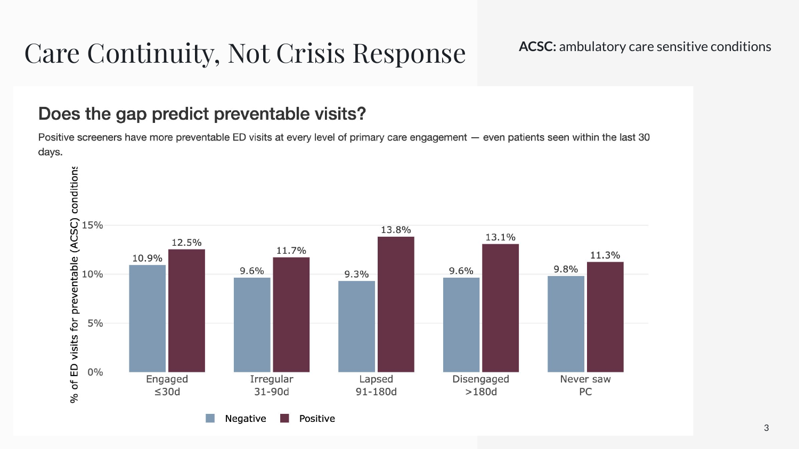

# Social Determinants of Health and ER Use as a Substitute for Primary Care

**ASA DataFest 2026, Cal Poly San Luis Obispo · Honorable Mention**

Team: Kenneth Carpenter, Grayson Six, Chloe Schurter, Mira Griffin

Do patients who screen positive for social needs, like housing instability, transportation barriers, or financial strain, use the emergency department instead of primary care? We analyzed four years (2022–2025) of electronic health records from Stormont Vail Health, a Midwest hospital system, covering **947,685 patients**.

## Key findings

- **About 3x the ER visit rate.** After adjusting for age and number of chronic conditions, patients who screened positive for financial resource strain had **3.04 times** the ED visit rate of patients who screened negative (95% CI: 2.88–3.21). That effect was larger than any age group or chronic condition in the model.
- **More preventable visits, even with regular primary care.** Positive screeners had a higher share of ED visits for preventable conditions at every level of primary care engagement, including patients seen by primary care within the last 30 days (12.5% vs. 10.9%).

## Who we studied

Every result is tied to a clearly defined cohort. The SQL funnel counts unique patients at each step, so the exclusions reconcile exactly: 61,453 approached − 603 who only declined = **60,850 in the study population**.

## Methods

**Data pipeline (DuckDB + SQL)**
- Loaded seven related tables (patients, encounters, diagnoses, departments, providers, social determinants, census codes) into a local DuckDB database with indexes on the join keys.
- Built the cohort in one query of CTEs, using `COUNT(DISTINCT PatientDurableKey)` so patients with many visits or answers were counted once.
- Filtered out non-responses ("Patient declined," "Patient unable to answer," "*Unknown") and used a `NOT IN` subquery to identify patients who only ever declined.
- Classified each answer as a positive or negative screen per domain with `CASE WHEN`, since positive answers differ by question (for financial strain, "Already shut off" counts as positive).
- Used a DuckDB window function to compute the days since each patient's last primary care visit before every ED visit.

**Cleaning rules**
- A patient who screened positive in a domain at any visit is treated as positive for that domain.
- Observation windows have a three-month minimum, so patients seen only briefly don't produce inflated visit rates.
- Missing or implausible ages are excluded. Extreme values are capped at the 99th percentile in charts only.

**Modeling**
- Negative binomial regression (`MASS::glm.nb`) on total ED visits, with `log(years observed)` as an offset, adjusting for age band and number of chronic conditions (capped at 5). Negative binomial fits overdispersed count data better than Poisson: most patients have few ED visits, and a small number have many.
- Stratified rate ratios by age band and comorbidity burden, with approximate 95% confidence intervals, to check that the effect holds within each subgroup.
- Preventable visits defined using ambulatory care sensitive conditions (ACSC), based on AHRQ Prevention Quality Indicators.

## Interactive dashboards (R Shiny)

| File | Question it answers |
|---|---|
| `sdoh_ed_app.R` | Do patients who screen positive for social needs use the ED more? Rates, risk ratios, and significance tests across domains |
| `adjusted_analysis_app.R` | Does the effect survive controls? Stratified rate ratios, a negative binomial forest plot, and a "what this analysis cannot do" section |
| `acsc_dashboard_app.R` | How much of the extra ED use is preventable, and which conditions drive it? |
| `gare_gap_app.R` | How long had patients gone without primary care before each ED visit, and does a longer gap predict preventable visits? |
| `roi_calculator_app.R` | Could investing in community health workers for these patients pay off? Adjustable assumptions, sensitivity analysis, and cited sources |
| `rural_comparison_app.R` | How do rural and urban patients' care journeys differ? |
| `screening_app.R` | How do cancer screening rates differ by sex and age group? |
| `app.R` | Patient journey viewer: one patient's encounters, diagnoses, and screenings on a timeline |

Supporting scripts: `build_database.R` (creates the DuckDB database), `cohort_queries.R` (cohort funnel and per-domain counts), `cohort_diagram.R` (draws the cohort flow diagram in ggplot2).

## Running it

The DataFest data was provided for the competition only, so **no patient data is included in this repository**. With access to the data:

1. Place the DataFest CSV files in this folder.
2. Run `build_database.R` to create `svh.duckdb`.
3. Launch any dashboard, for example `shiny::runApp("sdoh_ed_app.R")`.

R packages: `shiny`, `duckdb`, `DBI`, `dplyr`, `tidyr`, `ggplot2`, `plotly`, `DT`, `MASS`, `broom`.

## Limitations

- This is observational data, so the results show association, not causation.
- Only 61,453 of the 359,760 patients with a visit were ever screened for social needs. Screened patients may differ from those who weren't, so results describe the screened population.
- The ACSC list is an approximation of AHRQ's definitions, and the ROI calculator depends on assumptions drawn from published research rather than hospital cost data.

## Presentation

Our competition slides are in [`presentation/DataFest2026_slides.pdf`](presentation/DataFest2026_slides.pdf).
